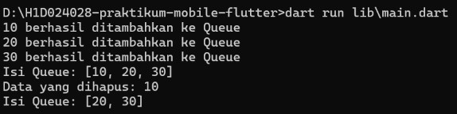
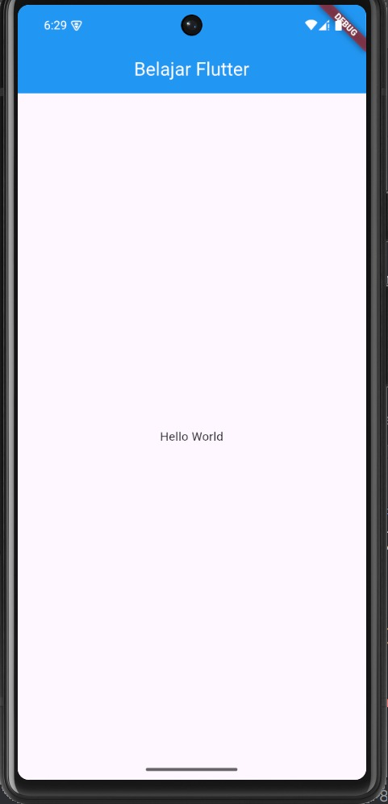
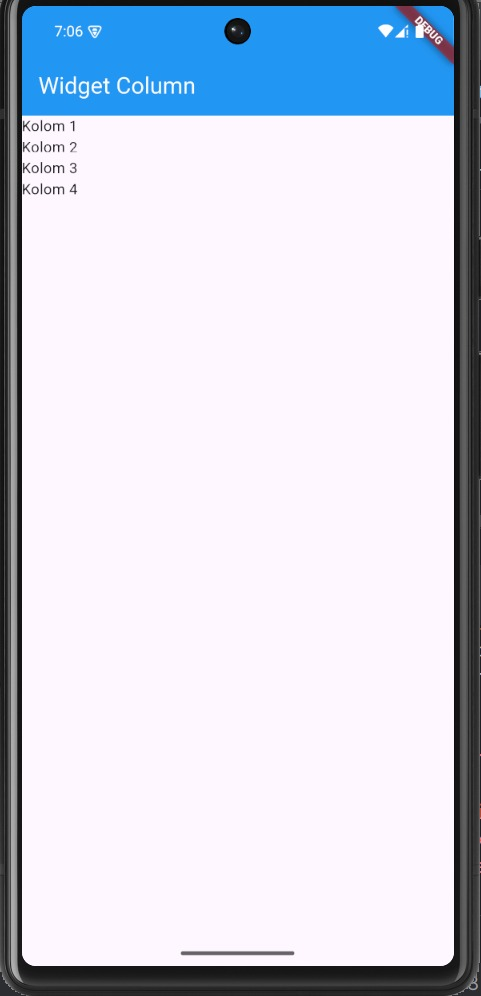
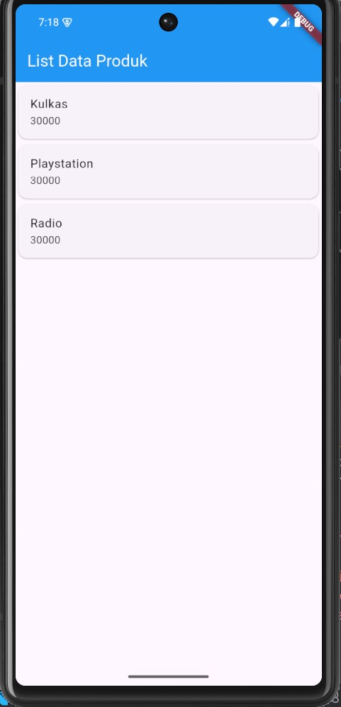

# Modul 1 Implementasi Queue Menggunakan Dart

## Deskripsi

Project ini dibuat untuk memenuhi penugasan Modul 1 Pemrograman Mobile, yaitu membuat repository baru dan mengimplementasikan struktur data Queue menggunakan bahasa pemrograman Dart.

Queue merupakan struktur data berbentuk antrean yang menerapkan prinsip FIFO (*First In, First Out*), yaitu elemen yang pertama masuk akan menjadi elemen pertama yang keluar. Implementasi ini menggunakan class `Queue` dengan method `enqueue()` dan `dequeue()` untuk mengelola data dalam antrean.

## Struktur Project

```text
H1D024028-praktikum-mobile-flutter/
├── bin/
│   └── h1_d024028_praktikum_mobile_flutter.dart
├── lib/
│   ├── main.dart
│   └── queue.dart
├── .gitignore
├── analysis_options.yaml
├── pubspec.lock
├── pubspec.yaml
└── README.md
```

## Implementasi

### 1. Class Queue

Class `Queue` digunakan untuk mengelola data antrean. Data disimpan dalam `List<int>` melalui atribut `_items`.

### 2. Method enqueue()

Method `enqueue(int value)` digunakan untuk menambahkan elemen ke bagian belakang antrean menggunakan `_items.add(value)`.

### 3. Method dequeue()

Method `dequeue()` digunakan untuk mengambil dan menghapus elemen paling depan menggunakan `_items.removeAt(0)`. Jika antrean kosong, method mengembalikan `null` dan menampilkan pesan bahwa Queue kosong.

### 4. Method tampilkanQueue()

Method `tampilkanQueue()` digunakan untuk menampilkan seluruh elemen yang tersimpan dalam antrean.

## Cara Menjalankan Program

Pastikan Dart SDK sudah terinstal. Buka terminal pada direktori project, kemudian jalankan perintah berikut:

```bash
dart run lib/main.dart
```

## Hasil Output

Berikut merupakan hasil output dari program Queue setelah dijalankan.

****

## Analisis Hasil

Program menambahkan tiga elemen, yaitu `10`, `20`, dan `30`, ke dalam Queue. Setelah method `dequeue()` dipanggil, elemen `10` dihapus karena merupakan elemen yang pertama kali masuk. Isi Queue kemudian berubah dari `[10, 20, 30]` menjadi `[20, 30]`.

Hasil tersebut menunjukkan bahwa implementasi Queue telah berjalan sesuai prinsip FIFO (*First In, First Out*).

## Kesimpulan

Implementasi struktur data Queue menggunakan Dart telah berhasil dilakukan. Class `Queue` memiliki method `enqueue()` untuk menambahkan elemen dan `dequeue()` untuk mengambil serta menghapus elemen paling depan. Hasil pengujian menunjukkan bahwa program berjalan sesuai prinsip FIFO.

# Modul 2 Pengenalan dan Desain Framework Flutter

Aplikasi Flutter sederhana yang dibuat untuk mempelajari dasar-dasar widget dan desain antarmuka pada Flutter. Aplikasi ini berisi form input produk, halaman detail produk, dan daftar produk menggunakan `ListView`.

---

## 📱 Tentang Aplikasi

Aplikasi ini dibangun menggunakan **Flutter** (bahasa pemrograman **Dart**) dan mencakup materi berikut:

- Struktur dasar aplikasi Flutter (`MaterialApp`, `Scaffold`, `AppBar`)
- `StatelessWidget` dan `StatefulWidget`
- Layout widget: `Column`, `Row`, `Container`, `Center`
- Form input dengan `TextField` dan `TextEditingController`
- Navigasi antar halaman dengan `Navigator.push`
- Menampilkan daftar data dengan `ListView`, `Card`, dan `ListTile`
- Memisahkan kode ke beberapa file `.dart`

---

## 🖼️ Screenshot

### 1. Hello World pada Flutter



---

### 2. Kolom pada flutter



---

### 3. List Data Produk



---

## 📂 Struktur Folder

```
lib/
├── main.dart              # Entry point aplikasi
├── hello_world.dart       # Halaman Hello World
├── column_widget.dart     # Contoh widget Column
├── row_widget.dart        # Contoh widget Row
└── ui/
    ├── produk_form.dart   # Form input produk (StatefulWidget)
    ├── produk_detail.dart # Detail produk (StatelessWidget)
    └── produk_page.dart   # List data produk (ListView)
```

---

## 🧩 Penjelasan File

| File | Jenis Widget | Keterangan |
|---|---|---|
| `main.dart` | StatelessWidget | Widget induk (`MyApp`) yang membungkus `MaterialApp` dan menentukan halaman `home` |
| `hello_world.dart` | StatelessWidget | Menampilkan teks "Hello World" di tengah layar menggunakan `Center` dan `Text` |
| `column_widget.dart` | StatelessWidget | Menyusun beberapa `Text` secara vertikal menggunakan `Column` |
| `row_widget.dart` | StatelessWidget | Menyusun beberapa `Text` secara horizontal menggunakan `Row` |
| `produk_form.dart` | StatefulWidget | Form dengan 3 `TextField` dan tombol `ElevatedButton` yang berpindah ke halaman detail |
| `produk_detail.dart` | StatelessWidget | Menerima data (kode, nama, harga) lewat constructor dan menampilkannya |
| `produk_page.dart` | StatefulWidget | Menampilkan 3 data produk dalam `ListView` berisi `Card` |

---

## ▶️ Cara Menjalankan

### Prasyarat
- [Flutter SDK](https://docs.flutter.dev/get-started/install)
- Android Studio **atau** VS Code (dengan extension Flutter & Dart)
- Emulator Android (AVD) atau perangkat Android fisik

### Langkah-langkah

1. **Clone repository**
   ```bash
   git clone <url-repository-kamu>
   cd <nama-folder-project>
   ```

2. **Install dependencies**
   ```bash
   flutter pub get
   ```

3. **Cek environment**
   ```bash
   flutter doctor
   ```

4. **Jalankan emulator** atau hubungkan perangkat Android, lalu jalankan:
   ```bash
   flutter run
   ```