# Modul 1 - Implementasi Queue Menggunakan Dart

## Deskripsi

Project ini dibuat untuk memenuhi penugasan Modul 1 Pemrograman Mobile, yaitu membuat repository baru dan mengimplementasikan struktur data Queue menggunakan bahasa pemrograman Dart.

Queue merupakan struktur data berbentuk antrean yang menerapkan prinsip FIFO (*First In, First Out*), yaitu elemen yang pertama masuk akan menjadi elemen pertama yang keluar. Implementasi ini menggunakan class `Queue` dengan method `enqueue()` dan `dequeue()` untuk mengelola data dalam antrean.

## Struktur Project

```text
H1D024028-praktikum-mobile-flutter/
├── bin/
│   └── h1_d024028_praktikum_mobile_flutter.dart
├── lib/
│   ├── main.dart
│   └── queue.dart
├── .gitignore
├── analysis_options.yaml
├── pubspec.lock
├── pubspec.yaml
└── README.md
```

## Implementasi

### 1. Class Queue

Class `Queue` digunakan untuk mengelola data antrean. Data disimpan dalam `List<int>` melalui atribut `_items`.

### 2. Method enqueue()

Method `enqueue(int value)` digunakan untuk menambahkan elemen ke bagian belakang antrean menggunakan `_items.add(value)`.

### 3. Method dequeue()

Method `dequeue()` digunakan untuk mengambil dan menghapus elemen paling depan menggunakan `_items.removeAt(0)`. Jika antrean kosong, method mengembalikan `null` dan menampilkan pesan bahwa Queue kosong.

### 4. Method tampilkanQueue()

Method `tampilkanQueue()` digunakan untuk menampilkan seluruh elemen yang tersimpan dalam antrean.

## Cara Menjalankan Program

Pastikan Dart SDK sudah terinstal. Buka terminal pada direktori project, kemudian jalankan perintah berikut:

```bash
dart run lib/main.dart
```

## Hasil Output

Berikut merupakan hasil output dari program Queue setelah dijalankan.

**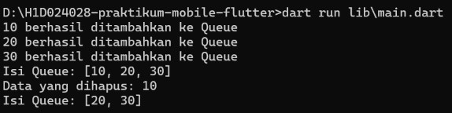**

## Analisis Hasil

Program menambahkan tiga elemen, yaitu `10`, `20`, dan `30`, ke dalam Queue. Setelah method `dequeue()` dipanggil, elemen `10` dihapus karena merupakan elemen yang pertama kali masuk. Isi Queue kemudian berubah dari `[10, 20, 30]` menjadi `[20, 30]`.

Hasil tersebut menunjukkan bahwa implementasi Queue telah berjalan sesuai prinsip FIFO (*First In, First Out*).

## Kesimpulan

Implementasi struktur data Queue menggunakan Dart telah berhasil dilakukan. Class `Queue` memiliki method `enqueue()` untuk menambahkan elemen dan `dequeue()` untuk mengambil serta menghapus elemen paling depan. Hasil pengujian menunjukkan bahwa program berjalan sesuai prinsip FIFO.

# Modul 2 - Pengenalan dan Desain Framework Flutter

## Deskripsi

Aplikasi Flutter sederhana yang dibuat untuk mempelajari dasar-dasar widget dan desain antarmuka pada Flutter. Aplikasi ini berisi form input produk, halaman detail produk, dan daftar produk menggunakan `ListView`.

## 📱 Tentang Aplikasi

Aplikasi ini dibangun menggunakan **Flutter** (bahasa pemrograman **Dart**) dan mencakup materi berikut:

- Struktur dasar aplikasi Flutter (`MaterialApp`, `Scaffold`, `AppBar`)
- `StatelessWidget` dan `StatefulWidget`
- Layout widget: `Column`, `Row`, `Container`, `Center`
- Form input dengan `TextField` dan `TextEditingController`
- Navigasi antar halaman dengan `Navigator.push`
- Menampilkan daftar data dengan `ListView`, `Card`, dan `ListTile`
- Memisahkan kode ke beberapa file `.dart`

## 🖼️ Screenshot

### 1. Hello World pada Flutter

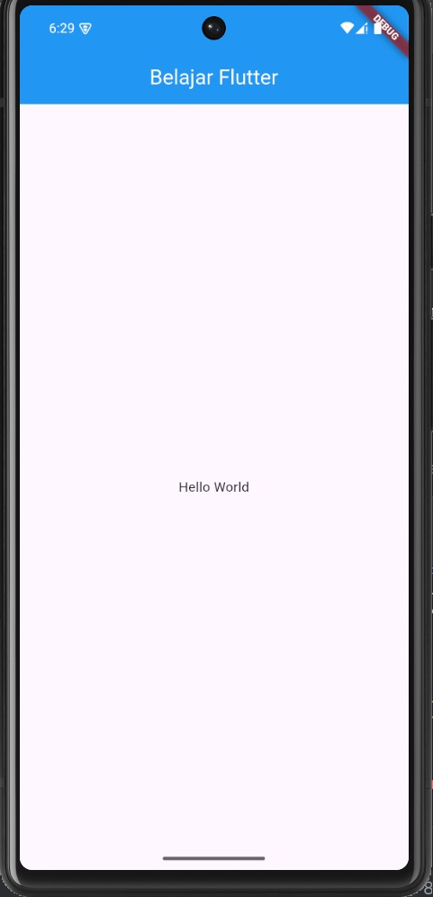

### 2. Kolom pada flutter

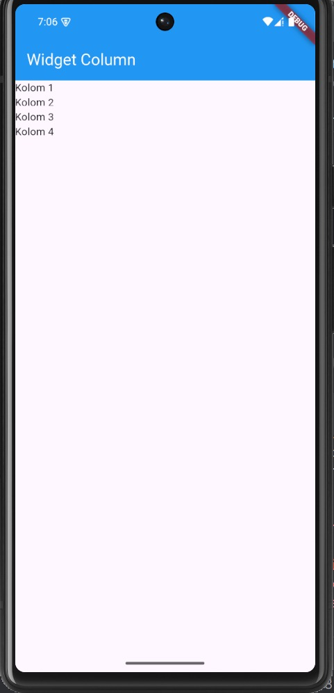

### 3. List Data Produk

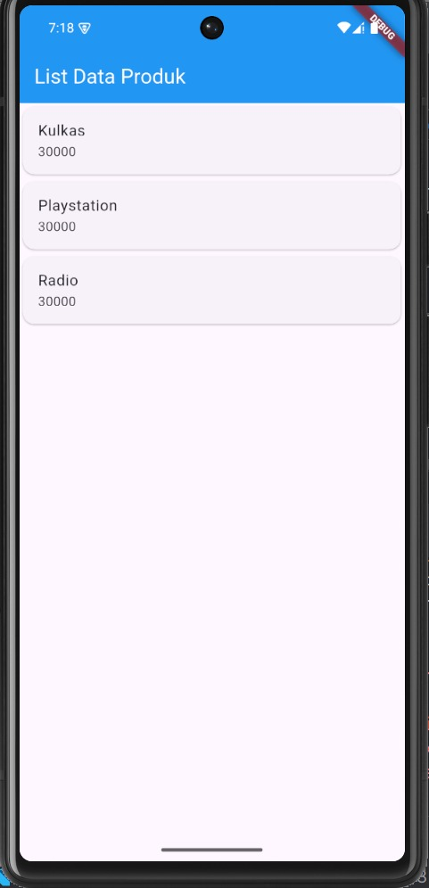

## 📂 Struktur Folder

```
lib/
├── main.dart              # Entry point aplikasi
├── hello_world.dart       # Halaman Hello World
├── column_widget.dart     # Contoh widget Column
├── row_widget.dart        # Contoh widget Row
└── ui/
    ├── produk_form.dart   # Form input produk (StatefulWidget)
    ├── produk_detail.dart # Detail produk (StatelessWidget)
    └── produk_page.dart   # List data produk (ListView)
```

## 🧩 Penjelasan File

| File | Jenis Widget | Keterangan |
|---|---|---|
| `main.dart` | StatelessWidget | Widget induk (`MyApp`) yang membungkus `MaterialApp` dan menentukan halaman `home` |
| `hello_world.dart` | StatelessWidget | Menampilkan teks "Hello World" di tengah layar menggunakan `Center` dan `Text` |
| `column_widget.dart` | StatelessWidget | Menyusun beberapa `Text` secara vertikal menggunakan `Column` |
| `row_widget.dart` | StatelessWidget | Menyusun beberapa `Text` secara horizontal menggunakan `Row` |
| `produk_form.dart` | StatefulWidget | Form dengan 3 `TextField` dan tombol `ElevatedButton` yang berpindah ke halaman detail |
| `produk_detail.dart` | StatelessWidget | Menerima data (kode, nama, harga) lewat constructor dan menampilkannya |
| `produk_page.dart` | StatefulWidget | Menampilkan 3 data produk dalam `ListView` berisi `Card` |


## ▶️ Cara Menjalankan

### Prasyarat
- [Flutter SDK](https://docs.flutter.dev/get-started/install)
- Android Studio **atau** VS Code (dengan extension Flutter & Dart)
- Emulator Android (AVD) atau perangkat Android fisik

### Langkah-langkah

1. **Clone repository**
   ```bash
   git clone <url-repository-kamu>
   cd <nama-folder-project>
   ```

2. **Install dependencies**
   ```bash
   flutter pub get
   ```

3. **Cek environment**
   ```bash
   flutter doctor
   ```

4. **Jalankan emulator** atau hubungkan perangkat Android, lalu jalankan:
   ```bash
   flutter run
   ```

# Modul 3 - Flutter Routes, Side Menu, Login dan Local Storage

## Deskripsi

Pada praktikum Modul 3 ini dilakukan pembuatan aplikasi Flutter yang memiliki fitur login, perpindahan halaman (routes), side menu, dan penyimpanan data menggunakan local storage.

Aplikasi ini menggunakan package `shared_preferences` untuk menyimpan username yang dimasukkan saat login. Setelah berhasil login, pengguna akan diarahkan ke halaman Home. Selain itu, terdapat side menu yang digunakan untuk berpindah ke halaman Home dan About.

### 1. Membuat Project Flutter
Membuat project Flutter baru melalui terminal dengan perintah:

```bash
flutter create nama_aplikasi
```

Setelah project berhasil dibuat, buka folder project menggunakan Visual Studio Code.

### 2. Menambahkan Dependencies
Menambahkan package `shared_preferences` pada file `pubspec.yaml` untuk menggunakan fitur local storage.

```yaml
dependencies:
  shared_preferences: ^2.0.17
```

Kemudian jalankan perintah:

```bash
flutter pub get
```

### 3. Membuat Halaman Login
Membuat file `login_page.dart` di dalam folder `lib` dengan menggunakan `StatefulWidget`.

Pada halaman login terdapat beberapa fungsi, yaitu:

- `_saveUsername()` untuk menyimpan username ke local storage.
- `_showInput()` untuk menampilkan input username dan password.
- `_showDialog()` untuk menampilkan pesan atau alert login.
- `build()` untuk membuat tampilan halaman login.

Login menggunakan username dan password `admin`. Jika data yang dimasukkan benar, aplikasi akan menampilkan pesan berhasil login dan mengarahkan pengguna ke halaman Home. Jika salah, pengguna akan kembali ke halaman Login.

### 4. Mengatur Halaman Utama
Pada file `main.dart`, halaman Login diatur sebagai halaman pertama yang ditampilkan ketika aplikasi dijalankan.

### 5. Membuat Home Page
Membuat file `home_page.dart` di dalam folder `lib`.

Pada halaman Home terdapat fungsi `_loadUsername()` yang digunakan untuk mengambil username yang sebelumnya telah disimpan di local storage. Username tersebut kemudian ditampilkan pada halaman Home.

### 6. Membuat Side Menu
Membuat file `sidemenu.dart` untuk menampilkan menu navigasi menggunakan komponen `Drawer` dan `ListTile`.

Side menu digunakan untuk memudahkan pengguna berpindah halaman. Pada praktikum ini terdapat dua menu, yaitu:
- **Home:** Untuk menuju halaman utama.
- **About:** Untuk menuju halaman About.

### 7. Membuat Halaman About
Membuat file `about_page.dart` sebagai halaman About. Halaman ini dapat diakses melalui menu About pada side menu.

## 🖼️ Screenshot

### 1. Halaman Login

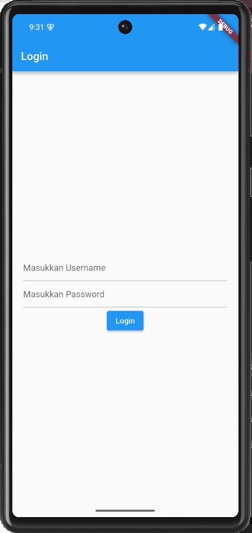

### 2. Halaman Home

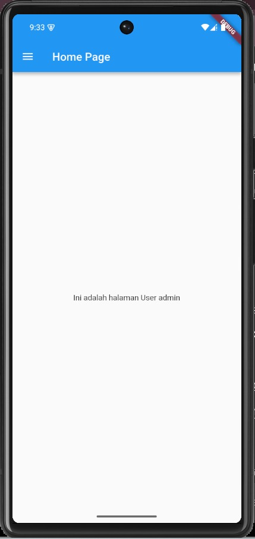

### 3. Side Menu

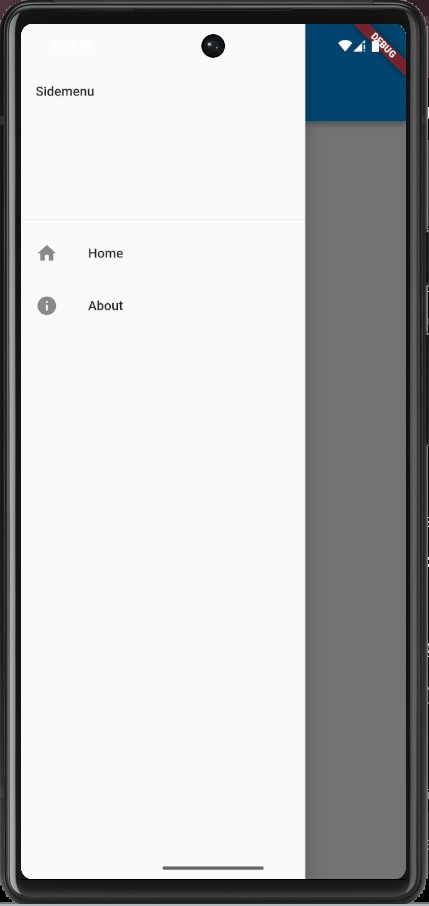

## 📂 Struktur Folder

```text
nama_aplikasi/
├── lib/
│   ├── main.dart
│   ├── login_page.dart
│   ├── home_page.dart
│   ├── sidemenu.dart
│   └── about_page.dart
├── pubspec.yaml
└── README.md
```

## ▶️ Cara Menjalankan

1. Buka folder project menggunakan Visual Studio Code.
2. Jalankan perintah berikut untuk mengunduh dependencies:

   ```bash
   flutter pub get
   ```

3. Jalankan aplikasi menggunakan emulator atau perangkat yang terhubung:

   ```bash
   flutter run
   ```

## Kesimpulan

Berdasarkan praktikum yang telah dilakukan, dapat dipahami cara membuat halaman login, mengatur perpindahan halaman menggunakan routes, membuat side menu menggunakan Drawer, serta menyimpan dan mengambil data username menggunakan shared_preferences sebagai local storage.

# MODUL 4 - CRUD (CREATE, READ, UPDATE, DELETE) FLUTTER

## Deskripsi

Pada praktikum Modul 4 ini dilakukan pembuatan aplikasi Toko Kita dengan menerapkan konsep CRUD (Create, Read, Update, Delete). Praktikum dimulai dengan membuat REST API menggunakan CodeIgniter 4 dan MySQL, kemudian dilanjutkan dengan pembuatan tampilan aplikasi menggunakan Flutter.

Aplikasi ini memiliki beberapa halaman, yaitu Login, Registrasi, List Produk, Tambah Produk, Detail Produk, dan Ubah Produk.

## A. Tools yang Digunakan

1. Visual Studio Code
2. Flutter dan Dart
3. XAMPP
4. CodeIgniter 4
5. MySQL
6. Postman
7. Android Studio dan Android Emulator

## B. Pembuatan REST API

### 1. Membuat Database

Database dibuat menggunakan phpMyAdmin dengan nama `toko_api`. Database ini memiliki tiga tabel, yaitu:

- `member`, untuk menyimpan data pengguna.
- `member_token`, untuk menyimpan token autentikasi pengguna.
- `produk`, untuk menyimpan data produk.

### 2. Konfigurasi CodeIgniter 4

Project CodeIgniter 4 dibuat dengan nama `toko-api`. Konfigurasi database dilakukan melalui file `app/Config/Database.php` agar aplikasi dapat terhubung dengan database MySQL `toko_api`.

### 3. Membuat Restful Controller

File `RestfulController.php` dibuat pada folder `app/Controllers`. Controller ini digunakan untuk mengatur format respons REST API dalam bentuk JSON.

### 4. Membuat API Registrasi

API Registrasi dibuat menggunakan model `MRegistrasi.php` dan controller `RegistrasiController.php`.

Endpoint yang digunakan:

- URL: `/registrasi`
- Method: `POST`

Data yang diperlukan untuk registrasi terdiri dari nama, email, dan password. Password disimpan dalam bentuk hash menggunakan fungsi `password_hash()`.

### 5. Membuat API Login

API Login dibuat menggunakan model `MMember.php`, `MLogin.php`, dan controller `LoginController.php`.

Endpoint yang digunakan:

- URL: `/login`
- Method: `POST`

Proses login dilakukan dengan memeriksa email dan password pengguna. Jika data sesuai, sistem akan membuat token autentikasi yang digunakan sebagai identitas pengguna.

### 6. Membuat API CRUD Produk

API Produk dibuat menggunakan model `MProduk.php` dan controller `ProdukController.php`.

API ini memiliki lima fungsi utama:

| Operasi | Endpoint | Method |
|---|---|---|
| Create Produk | `/produk` | POST |
| List Produk | `/produk` | GET |
| Detail Produk | `/produk/{id}` | GET |
| Update Produk | `/produk/{id}` | PUT |
| Delete Produk | `/produk/{id}` | DELETE |

Setiap fungsi digunakan untuk menambahkan, menampilkan, mengubah, dan menghapus data produk pada database.

## C. Pembuatan Aplikasi Flutter

### 1. Membuat Project Flutter

Project Flutter dibuat dengan nama `tokokita` dan disimpan di dalam folder `modul4` pada repository praktikum Flutter.

### 2. Membuat Model

Folder `model` dibuat di dalam folder `lib` untuk menyimpan model data yang digunakan dalam aplikasi.

File model yang dibuat:

- `login.dart`, untuk mengelola data respons login.
- `registrasi.dart`, untuk mengelola data respons registrasi.
- `produk.dart`, untuk mengelola data produk.

### 3. Membuat Halaman Registrasi

Halaman Registrasi dibuat menggunakan file `registrasi_page.dart`. Halaman ini memiliki empat input, yaitu Nama, Email, Password, dan Konfirmasi Password. Pada halaman ini juga terdapat validasi untuk memastikan data yang dimasukkan sesuai dengan ketentuan.

### 4. Membuat Halaman Login

Halaman Login dibuat menggunakan file `login_page.dart`. Halaman ini memiliki dua input, yaitu Email dan Password, serta tombol Login. Terdapat juga menu Registrasi yang dapat digunakan untuk berpindah ke halaman pendaftaran pengguna.

### 5. Membuat Form Produk

File `produk_form.dart` digunakan untuk membuat form penambahan dan perubahan data produk. Form ini memiliki tiga input, yaitu Kode Produk, Nama Produk, dan Harga. Form menggunakan satu tampilan yang dapat digunakan untuk menambahkan maupun mengubah data produk.

### 6. Membuat Halaman Detail Produk

File `produk_detail.dart` digunakan untuk menampilkan informasi detail produk berupa kode, nama, dan harga produk. Pada halaman ini terdapat tombol EDIT untuk membuka form perubahan produk dan DELETE untuk menampilkan dialog konfirmasi penghapusan.

### 7. Membuat Halaman List Produk

File `produk_page.dart` digunakan untuk menampilkan daftar produk dalam bentuk list. Halaman ini dilengkapi tombol tambah produk dan menu Logout. Data produk yang ditampilkan pada tahap ini masih menggunakan data contoh sesuai materi praktikum.

## D. Screenshot

### 1. Halaman Registrasi

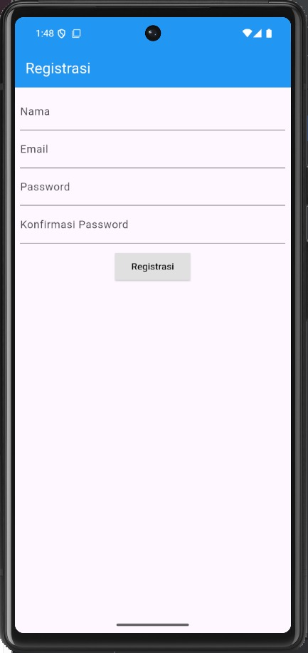

### 2. Halaman Login

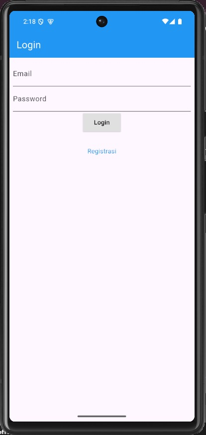

### 3. Halaman List Produk

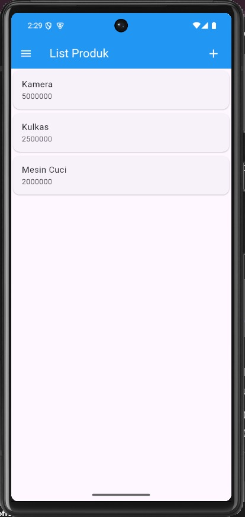

### 4. Halaman Tambah Produk

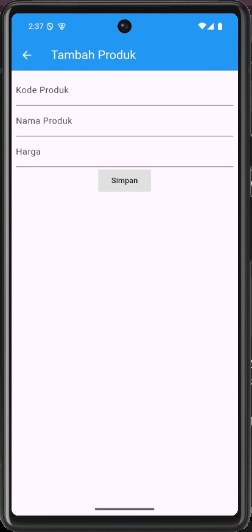

### 5. Halaman Detail Produk

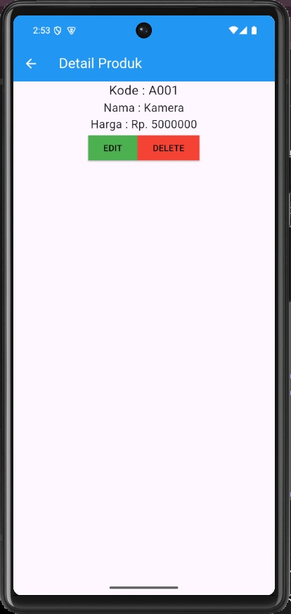

### 6. Halaman Ubah Produk

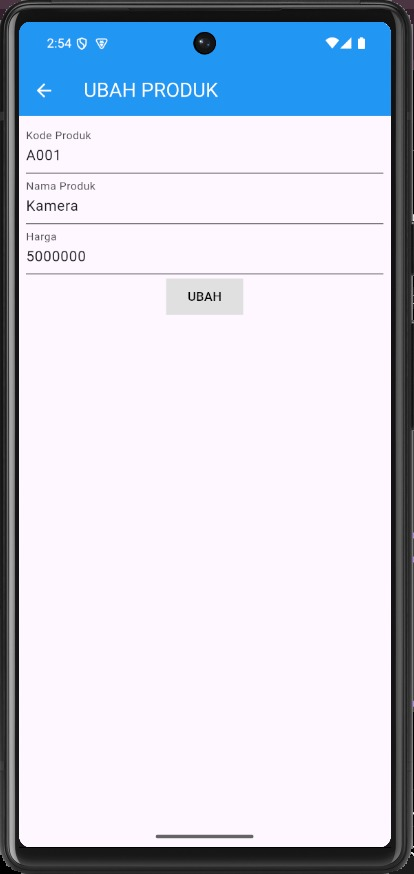

## E. Kesimpulan

Melalui praktikum Modul 4, dapat dipahami cara membuat REST API menggunakan CodeIgniter 4 dan MySQL serta membuat tampilan aplikasi mobile menggunakan Flutter.

Praktikum ini juga memberikan pemahaman mengenai konsep CRUD, pembuatan model, penggunaan form, validasi input, serta navigasi antarhalaman pada Flutter.

Siap, bagian **Hasil Output** diganti menjadi **Screenshot**, dan bagian **Analisis Hasil** dihapus. Berikut README yang sudah direvisi:

# Modul 5 - Implementasi CRUD Menggunakan Flutter

## Deskripsi

Project ini dibuat untuk memenuhi penugasan Modul 5 Pemrograman Mobile, yaitu mengimplementasikan fitur CRUD (*Create, Read, Update, Delete*) pada aplikasi mobile menggunakan Flutter dan bahasa pemrograman Dart.

Aplikasi yang dibuat bernama **Toko Kita**, yaitu aplikasi sederhana untuk mengelola data produk. Aplikasi ini menggunakan REST API sebagai penghubung antara aplikasi Flutter dengan database. Selain itu, terdapat fitur registrasi, login, dan logout untuk mengelola autentikasi pengguna.

## 📂 Struktur Project

```
modul5/
├── lib/
│   ├── bloc/
│   │   ├── login_bloc.dart
│   │   ├── logout_bloc.dart
│   │   ├── registrasi_bloc.dart
│   │   └── produk_bloc.dart
│   ├── helpers/
│   │   ├── api.dart
│   │   ├── api_exception.dart
│   │   ├── api_url.dart
│   │   └── user_info.dart
│   ├── model/
│   │   ├── login.dart
│   │   ├── registrasi.dart
│   │   └── produk.dart
│   ├── ui/
│   │   ├── login_page.dart
│   │   ├── registrasi_page.dart
│   │   ├── produk_page.dart
│   │   ├── produk_detail.dart
│   │   └── produk_form.dart
│   ├── widget/
│   │   ├── success_dialog.dart
│   │   └── warning_dialog.dart
│   └── main.dart
├── .gitignore
├── pubspec.lock
├── pubspec.yaml
└── README.md
```

## Implementasi

### 1. Helper Modul

Folder `helpers` digunakan untuk membantu proses komunikasi antara aplikasi Flutter dengan REST API.

Beberapa file yang dibuat yaitu:

- `user_info.dart` digunakan untuk menyimpan dan mengambil token serta ID pengguna menggunakan Shared Preferences.
- `api_exception.dart` digunakan untuk menangani kesalahan saat melakukan request ke REST API.
- `api.dart` digunakan untuk mengirim dan menerima request menggunakan method POST, GET, dan DELETE.
- `api_url.dart` digunakan untuk menyimpan alamat URL dan endpoint REST API.

### 2. Bloc

Folder `bloc` digunakan untuk mengatur proses pengolahan data dan komunikasi dengan REST API.

Beberapa class yang dibuat yaitu:

- `registrasi_bloc.dart` digunakan untuk melakukan registrasi pengguna.
- `login_bloc.dart` digunakan untuk melakukan proses login.
- `logout_bloc.dart` digunakan untuk menghapus data autentikasi pengguna.
- `produk_bloc.dart` digunakan untuk mengambil, menambahkan, mengubah, dan menghapus data produk.

### 3. Model

Folder `model` digunakan untuk membuat class yang merepresentasikan data dari REST API.

Beberapa model yang digunakan yaitu `login.dart`, `registrasi.dart`, dan `produk.dart`.

### 4. Halaman Login dan Registrasi

Halaman login digunakan untuk memasukkan email dan password pengguna. Jika login berhasil, token dan ID pengguna akan disimpan menggunakan Shared Preferences, kemudian pengguna diarahkan ke halaman daftar produk.

Halaman registrasi digunakan untuk membuat akun baru dengan mengisi nama, email, password, dan konfirmasi password. Terdapat validasi input serta dialog untuk menampilkan pesan berhasil atau gagal.

### 5. Fitur CRUD Produk

Implementasi CRUD merupakan fitur utama pada aplikasi Toko Kita.

- **Create:** Menambahkan data produk baru melalui halaman form produk dengan mengisi kode produk, nama produk, dan harga produk.
- **Read:** Menampilkan daftar produk yang diperoleh dari REST API serta melihat detail produk.
- **Update:** Mengubah data produk yang sudah tersimpan melalui halaman form ubah produk.
- **Delete:** Menghapus data produk melalui halaman detail dengan konfirmasi sebelum penghapusan.

### 6. Widget Dialog

Folder `widget` berisi dua komponen dialog yang digunakan untuk memberikan informasi kepada pengguna.

- `success_dialog.dart` digunakan untuk menampilkan pesan ketika proses berhasil.
- `warning_dialog.dart` digunakan untuk menampilkan pesan ketika proses mengalami kegagalan.

## ▶️ Cara Menjalankan Program

Pastikan Flutter SDK sudah terinstal dan REST API sudah dijalankan serta dapat diakses oleh emulator atau perangkat Android.

Buka terminal pada direktori project, kemudian jalankan perintah berikut:

```
flutter pub get
```

Setelah dependencies berhasil diunduh, jalankan aplikasi menggunakan perintah:

```
flutter run
```

## 🖼️ Screenshot

### 1. Halaman Registrasi

Jika registrasi berhasil, akan muncul pesan seperti berikut.

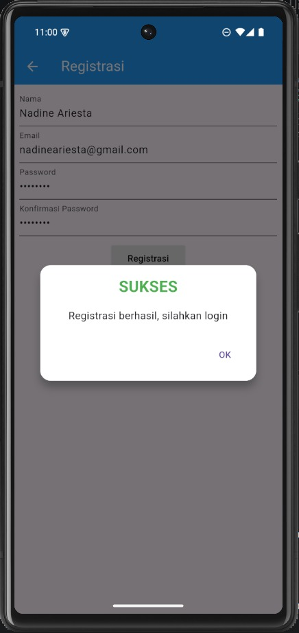

### 2. Halaman Login

Jika login gagal, akan muncul pesan seperti berikut.

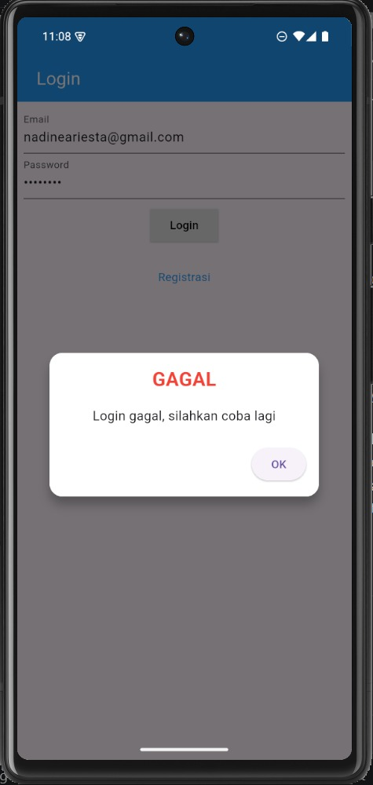

### 3. List Produk

Berikut merupakan tampilan halaman list produk.

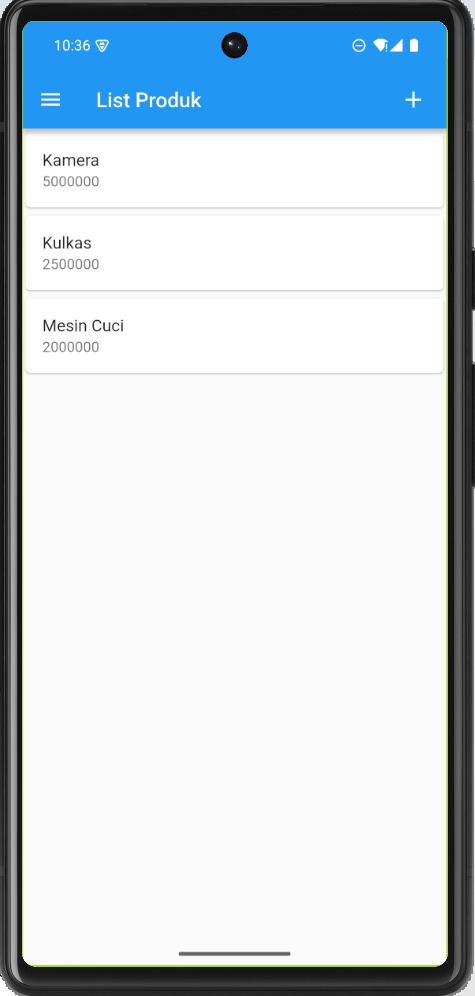 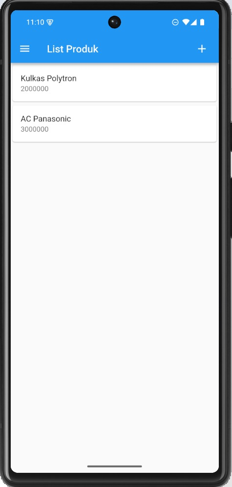

## Kesimpulan

Implementasi CRUD menggunakan Flutter telah dilakukan melalui pembuatan aplikasi Toko Kita. Aplikasi ini memiliki fitur registrasi, login, logout, serta pengelolaan data produk yang meliputi Create, Read, Update, dan Delete.

Selain itu, penggunaan REST API, Shared Preferences, Bloc, dan Model membantu mengatur proses komunikasi serta pengolahan data pada aplikasi. Dengan demikian, aplikasi dapat digunakan untuk mempelajari penerapan CRUD dan integrasi REST API pada pengembangan aplikasi mobile.